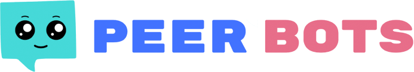

# Peerbots

**Peerbots makes it easy to learn about, design, and control social robots that you build from materials you already have.**

  
  
  
  

---

## What Is Peerbots?

[**Peerbots, Inc.**](https://www.peerbots.org) is a **501(c)(3) research-informed tech nonprofit** on a mission to build **social robots for everyone, powered by experts**.

Rather than taking an AI-first approach that hands control to black-box automations, Peerbots takes a **people-first approach** — building free, robot-agnostic tools that put **therapists, educators, librarians, parents, artists, performers, researchers, and makers** in charge of their own stories and interactions. Turn any phone or tablet into a robot face, control multiple robots (Peerbots Face, Misty, Furhat) without vendor lock-in, author and share scripts, or 3D-print custom robot hardware from low-cost parts — no programming experience required to start.

We partner with researchers and disability advisors to **raise the floor** of social robotics through Universal Design, neurodiversity-affirming co-design, and open-source technology free from profit motives.

---

## The Peerbots Ecosystem

| Repository | What It Does | Availability | License |
| :--- | :--- | :--- | :--- |
| [**app.peerbots.org**](https://github.com/PEERbots/app.peerbots.org) | Main Peerbots Controller & Interaction Authoring Platform | Live at [app.peerbots.org](https://app.peerbots.org) | `AGPL-3.0-or-later` |
| [**peerbots-face**](https://github.com/PEERbots/peerbots-face) | 2D (PixiJS) & 3D (Vizij) expressive robot face engine | npm: [`@peerbots/face`](https://www.npmjs.com/package/@peerbots/face) | `LGPL-3.0-or-later` *(code)* / Hugo & Simple brand assets reserved |
| [**peerbots-core**](https://github.com/PEERbots/peerbots-core) | Shared accessible UI components & Peerbots design system | npm: [`@peerbots/core`](https://www.npmjs.com/package/@peerbots/core) | `LGPL-3.0-or-later` |
| [**peerbots-content**](https://github.com/PEERbots/peerbots-content) | Community Marketplace for free robot scripts & behaviors | Live at [market.peerbots.org](https://market.peerbots.org) | `AGPL-3.0-or-later` |
| [**Moddy**](https://github.com/PEERbots/Moddy) | Programmatic 3D-printable modular robot building blocks | FreeCAD + Web Designer | `AGPL-3.0-or-later` *(code)* / `CC BY-NC-SA 4.0` *(designs)* |
| [**api**](https://github.com/PEERbots/api) | Real-time WebSocket & REST backend service | Self-hostable / API | `AGPL-3.0-or-later` |
| [**api-samples**](https://github.com/PEERbots/api-samples) | Copy-pasteable sample code for the Peerbots API | Open Samples | `MIT` |
| [**constrained-face-agent**](https://github.com/PEERbots/constrained-face-agent) | Template-constrained conversational robot face app | Hosted / Self-hostable | `AGPL-3.0-or-later` |
| [**course-in-a-box**](https://github.com/PEERbots/course-in-a-box) | Free self-paced Peerbots training courses & curriculum | Open Curriculum | `MIT` *(code)* / `CC BY-SA 4.0` *(content)* |
| [**halloween-competition-runner**](https://github.com/PEERbots/halloween-competition-runner) | Annual Peerbots Halloween Robot Competition platform | Hosted / Open Source | `AGPL-3.0-or-later` |
| [**peerbots.org**](https://github.com/PEERbots/peerbots.org) | Official Peerbots nonprofit website | Live at [peerbots.org](https://www.peerbots.org) | `AGPL-3.0-or-later` *(code)* |

---

## Community, Licensing & Getting Involved

- **Questions & Ideas**: [Peerbots GitHub Discussions](https://github.com/PEERbots/.github/discussions)
- **How to Contribute**: [Contributing Guide](../CONTRIBUTING.md) · [FLA 2.0 CLA](../CLA.md) · [QA Standards](../docs/QA_STANDARDS.md)
- **Why We Chose Our Licenses**: [Peerbots Licensing & Trademark Policy](../LICENSING.md)
- **Community Standards & Governance**: [Code of Conduct](../CODE_OF_CONDUCT.md) · [Governance](../GOVERNANCE.md) · [Security Policy](../SECURITY.md)
- **Trainings, Support & Custom Implementations**: [peerbots.org/contact](https://www.peerbots.org/contact)

---

## Sponsors & Supporters

Peerbots, Inc. is a **501(c)(3) nonprofit** (EIN `85-1894594`). Tax-deductible donations, GitHub Sponsors, commercial code licenses, and hands-on training/support services keep Peerbots free for schools, therapists, libraries, and families.

- **[Sponsor on GitHub](https://github.com/sponsors/PEERbots)** · **[Donate at peerbots.org/donate](https://www.peerbots.org/donate)** · **[Sponsorship Tiers & Priority Support](../SPONSORSHIP.md)**

### Open-Source & Nonprofit Infrastructure Supporters
We're grateful to the platforms that support open-source nonprofits with free tooling and infrastructure:
- **[GitHub for Nonprofits](https://socialimpact.github.com/)** — Source hosting, Actions CI, and community collaboration
- *(Additional OSS tooling supporters — such as BrowserStack Open Source once approved — will be credited here.)*
